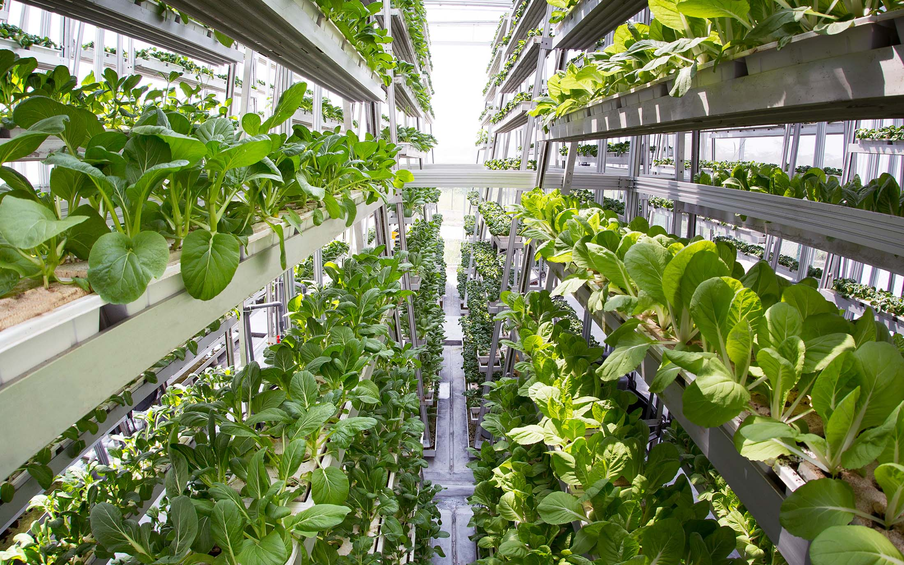
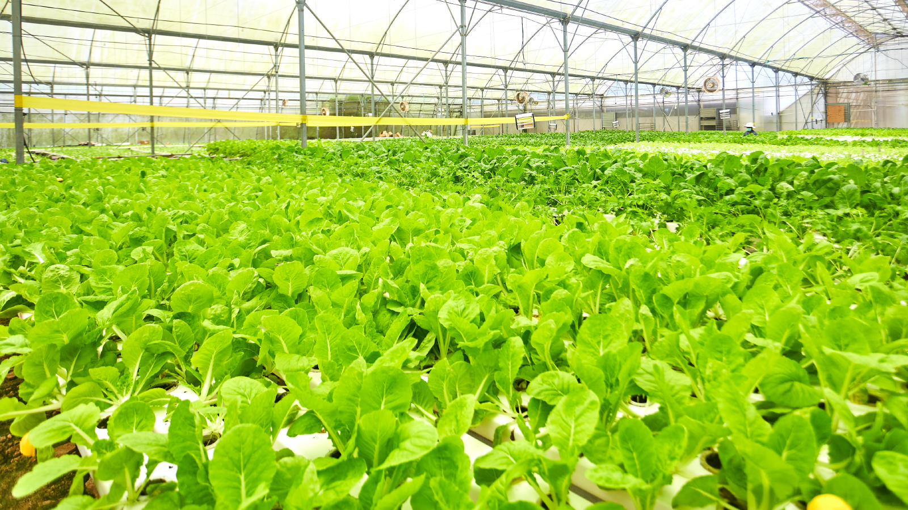

# SproutScan

Farm management web app for tracking crop statistics with cameras and data —
built so that it stays simple enough for anyone, including elderly farmers,
to see costs, profits, and quantities at a glance.

**Author:** Jonathan Choe (github.com/Somewhatmilk) — primary contributor and
maintainer. The initial codebase came from a school team project during the
2025/26 web-development semester; this repository is the actively refined,
secured, and extended continuation of that work.

## Showcase

Product captures from the app's own media folder — camera-zone views used in
the farm dashboard:

 

 

 

## What it does

- Track plantations and crop-stage progress per zone on a farm
- Log pest sightings and incidents against crops
- Record and retrieve reports (yield, cost, profit, quantity)
- Camera-connected zones with AI confidence status (`Normal` / `Needs to be checked`)
- Login with optional two-factor authentication (TOTP)

## Why

The goal is a tool a farmer can use daily without a manual. Plain pages,
clear labels, and data that answers "what did I plant, what did it cost,
what is it worth now" — without hiding anything behind jargon.

## Tech stack

- **Backend:** Python (Flask, WTForms, Werkzeug)
- **Data:** SQLite (single file, zero setup)
- **Frontend:** Jinja2 templates + vanilla JS + CSS
- **AI/logs:** camera-zone confidence logs rendered in the UI
- **Tests:** Node.js built-in test runner (`node --test`)

## Tests

Both suites are runnable and passing:

```bash
# JS helpers (no install needed)
node --test tests/crop-utils.test.js

# Flask smoke tests (after pip install -r req.txt)
.venv/Scripts/python.exe -m pytest tests/test_app.py -q
```

## Docs

- [`docs/PROJECT_OUTLINE.md`](docs/PROJECT_OUTLINE.md) — pages, data model, camera/AI flow, planned addons

## Quick start

```bash
# 1. Python environment
python -m venv .venv
source .venv/bin/activate        # Windows: .venv\Scripts\activate
pip install -r req.txt

# 2. Configure
#    Copy the example env file and fill in real values.
cp .env.example .env

# 3. Run
python app.py
#    Open http://127.0.0.1:5000
```